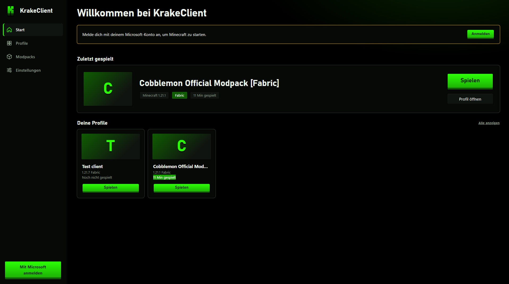

# ✦ KRAKE CLIENT

**Redefine your gameplay.**

A modern Minecraft client built for performance, customization, and a smoother experience.

 

 

[Features](#-features) •
[Showcase](#-showcase) •
[Installation](#-installation) •
[Community](#-community)

---

## ✦ About

YOUR CLIENT is a customizable Minecraft client focused on a clean interface, flexible settings, and an enhanced gameplay experience.

Designed with simplicity and performance in mind, it brings useful tools and personalization together in one place.

## ⚡ Features

<table>
  <tr>
    <td width="50%">
      <h3>🎨 Customization</h3>
      Personalize your HUD, interface, colors, and client settings.
    </td>
    <td width="50%">
      <h3>🧩 Modular System</h3>
      Enable, disable, and configure modules to suit your playstyle.
    </td>
  </tr>
  <tr>
    <td width="50%">
      <h3>🖥️ Modern Interface</h3>
      A clean ClickGUI designed for convenient in-game configuration.
    </td>
    <td width="50%">
      <h3>🚀 Performance</h3>
      A focus on responsiveness, smooth gameplay, and efficient operation.
    </td>
  </tr>
  <tr>
    <td width="50%">
      <h3>📊 HUD Editor</h3>
      Arrange and customize on-screen elements to your preference.
    </td>
    <td width="50%">
      <h3>⚙️ Flexible Settings</h3>
      Configure available features with individual options.
    </td>
  </tr>
</table>

> Features listed above are planned or illustrative until implemented.

## 📸 Showcase

### Main Menu

### In-Game

### ClickGUI

## 📥 Installation

1. Go to the [Releases](../../releases) page.
2. Download the appropriate build, when available.
3. Follow the installation instructions for your Minecraft version.
4. Launch the game and configure your client.

**Note:** Installation instructions and supported versions will be added as the project develops.

## 🛠️ Development

Interested in the technical side?

- Language: Java *(if applicable)*
- Build system: To be announced
- Minecraft version: To be announced

More technical documentation will be added as development progresses.

## 🗺️ Roadmap

- [ ] Core client framework
- [ ] Modern ClickGUI
- [ ] Customizable HUD
- [ ] Module configuration system
- [ ] Settings persistence
- [ ] Screenshots and showcase
- [ ] Release builds and documentation

## 💬 Community

Have questions or feedback?

- **Issues:** [Report a bug or suggest a feature](../../issues)
- **Discussions:** [Join the conversation](../../discussions)

## 📄 License

KrakeClient is proprietary software. All rights reserved.

You may view the source code for informational purposes only. Copying, modifying, redistributing, or using this software without prior written permission from the copyright holder is not permitted.

See the repository owner for permissions or inquiries.

---

**YOUR CLIENT**

*Built with passion. Designed for your playstyle.*

© 2026 KRAKE CLIENT. All rights reserved.

